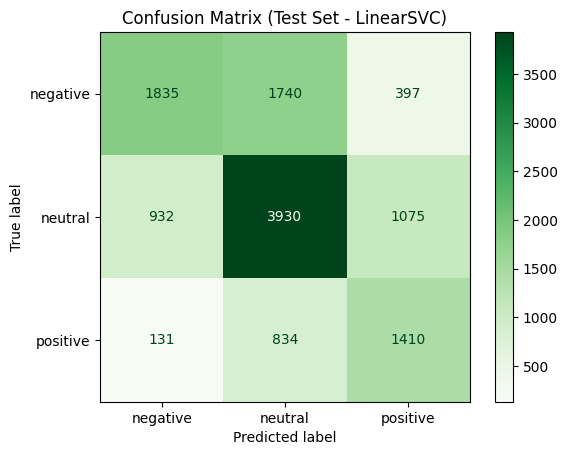

# Intelligent Multi-Class Natural Language Text Sentiment Classifier

A multi-class sentiment classifier that maps unstructured text (tweets) into **negative**, **neutral** or **positive** classes. The pipeline uses NLTK for preprocessing (stop-word removal and lemmatization), TF-IDF for feature extraction, and Scikit-Learn linear models for classification, evaluated with F1-score metrics.

[

## Table of Contents

- [Overview](#overview)
- [Dataset](#dataset)
- [Pipeline](#pipeline)
- [Results](#results)
- [Project Structure](#project-structure)
- [Getting Started](#getting-started)
- [Usage](#usage)
- [Limitations](#limitations)
- [Future Improvements](#future-improvements)

## Overview

**Objective:** program an NLP classifier that maps and groups unstructured text statements by the sentiment they express.

**Requirements covered:**

| Requirement | Implementation |
|---|---|
| Text classification model in Python | Scikit-Learn (`LogisticRegression`, `LinearSVC`) |
| Remove stop-words and apply lemmatization | NLTK English stop-words and `WordNetLemmatizer` |
| Convert text to numerical data | `TfidfVectorizer` (unigrams and bigrams) |
| Evaluate with F1-score metrics | Per-class F1, macro-F1, weighted-F1, confusion matrix |

## Dataset

[TweetEval](https://huggingface.co/datasets/cardiffnlp/tweet_eval) (`sentiment` configuration), loaded with the Hugging Face `datasets` library.

| Split | Samples |
|---|---|
| Train | 45,615 |
| Validation | 2,000 |
| Test | 12,284 |

Labels: `0 = negative`, `1 = neutral`, `2 = positive`.

## Pipeline

1. **Preprocessing**
   - Lower-case the text
   - Remove URLs, @mentions and `#` symbols
   - Remove punctuation and digits
   - Remove English stop-words (negations `no`, `not`, `nor`, `never` are **kept**, so "not good" does not become "good")
   - Lemmatize with WordNet
2. **Feature extraction:** TF-IDF with unigrams and bigrams, `min_df=2`, `max_features=50000`. The vectorizer is fitted on the training set only to avoid data leakage.
3. **Models:** Logistic Regression and LinearSVC, both with `class_weight="balanced"`. The model with the higher validation macro-F1 is selected.
4. **Evaluation:** classification report (precision, recall, F1), macro-F1, weighted-F1 and a confusion matrix on the held-out test set.

## Results

### Experiment progression

Macro-F1 values come from the notebook's classification reports.

| Run | TF-IDF setting | Model | Validation macro-F1 | Test macro-F1 |
|---|---|---|---|---|
| 1 | 10,000 features, 1-2 grams | Logistic Regression (C=1.0) | 0.61 | - |
| 1 | 10,000 features, 1-2 grams | LinearSVC (C=0.5) | 0.63 | 0.57 |
| 2 | 50,000 features, `min_df=2` | LinearSVC (C=0.5) | 0.63 | 0.57 |
| 3 | 50,000 features, `min_df=2` | Logistic Regression, balanced | 0.636 | 0.569 |
| 3 | 50,000 features, `min_df=2` | LinearSVC, balanced | 0.631 | - |

### Final model: Logistic Regression (balanced), test set

| Class | Precision | Recall | F1-score | Support |
|---|---|---|---|---|
| Negative | 0.52 | 0.72 | 0.60 | 3,972 |
| Neutral | 0.65 | 0.48 | 0.56 | 5,937 |
| Positive | 0.54 | 0.55 | 0.55 | 2,375 |
| **Macro average** | 0.57 | 0.58 | **0.57** | 12,284 |
| **Weighted average** | 0.59 | 0.57 | 0.57 | 12,284 |

**Accuracy:** 0.57 | **Macro-F1:** 0.5685 | **Weighted-F1:** 0.5692



### Key observations

- Neutral tweets are the hardest to separate: about 37% of them (2,197 of 5,937) are predicted as negative.
- Balanced class weights raised negative recall from 0.46 to 0.72 compared with the unweighted LinearSVC, but lowered neutral recall from 0.66 to 0.48. Macro-F1 stayed about the same, so balancing shifted errors between classes rather than improving overall performance.
- Validation macro-F1 (about 0.63) is higher than test macro-F1 (0.57). The class mix differs between the splits (negative tweets are about 16% of validation but about 32% of test), and the validation set is small.

## Project Structure

```
.
├── sentiment_classifier.ipynb   # Full notebook (Google Colab)
├── images/
│   └── confusion_matrix_test.png
├── requirements.txt
└── README.md
```

## Getting Started

### Option 1: Google Colab (recommended)

1. Click the **Open In Colab** badge above, or upload `sentiment_classifier.ipynb` at [colab.research.google.com](https://colab.research.google.com).
2. Select **Runtime → Run all**.

### Option 2: Run locally

```bash
git clone https://github.com/<your-username>/<your-repo>.git
cd <your-repo>
pip install -r requirements.txt
jupyter notebook sentiment_classifier.ipynb
```

`requirements.txt`:

```
scikit-learn
nltk
pandas
numpy
matplotlib
datasets
jupyter
```

NLTK data (`stopwords`, `wordnet`, `omw-1.4`) is downloaded automatically by the first notebook cell.

## Usage

After running the notebook, classify new sentences with the trained pipeline:

```python
def predict(texts):
    features = tfidf.transform([preprocess(t) for t in texts])
    return [labels[i] for i in best.predict(features)]

predict(["I love this phone!", "This was a terrible experience", "The meeting is at 5pm"])
# ['positive', 'negative', 'neutral']
```

## Limitations

- TF-IDF ignores word order beyond two-word phrases and cannot capture context, sarcasm or slang well.
- Neutral text has no strong sentiment words, which makes it the most confused class.
- The separate effects of keeping negation words and of using bigrams were not measured in an ablation.

## Future Improvements

- Tune hyperparameters (`C`, `ngram_range`, `max_features`) with `GridSearchCV` and cross-validation.
- Replace TF-IDF with sentence embeddings (for example, `sentence-transformers`) and compare.
- Fine-tune a transformer such as DistilBERT or RoBERTa with PyTorch.
- Run ablations on negation handling and bigrams.

## License

Add a license of your choice (for example, MIT) as a `LICENSE` file.
